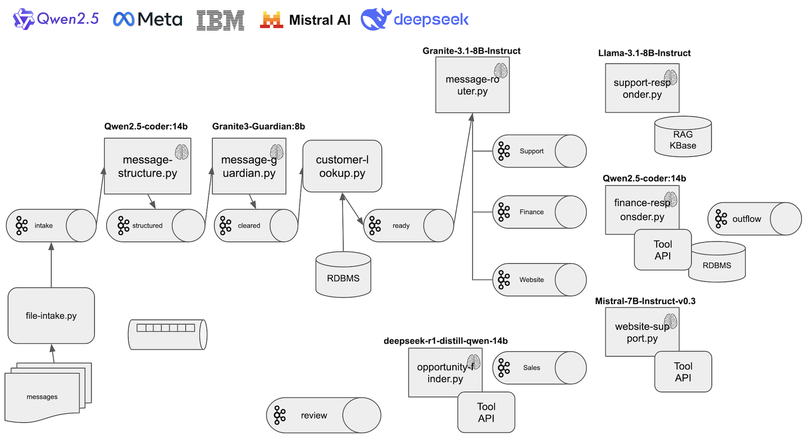

# AI Message Triage

A Kafka-based system for automated email message analysis and triage using LLMs (Large Language Models). This project processes customer support emails through a pipeline that analyzes content, extracts key information, and routes messages based on their characteristics.

Note: This is a totally "hacked together" codebase.  Needs an investment of time to really analyze the input/output Pydantic message definitions.  Python's dynamic typing makes for some more interesting debugging opportunities when the str, dict and Pydantic models are not aligned perfectly.   A proper microservices architecture would have very strict rules over the message JSON schema making for easier testing interoperability. 

## Features

- Kafka-based message processing pipeline
- LLM-powered email analysis
- Automatic extraction of:
  - Customer information
  - Email content
  - Sentiment analysis
  - Product references
  - Escalation requirements
- Real-time message routing
- Error handling and message review system

## Architecture

A series of processors that take input, often send it through a LLM and produce output.



opportunity-finder.py uses a reasoning model to generate code instead of using a simplier and more robust solution of Structured Output or Tool. 


## ToDos

The Kafka input/output is fairly boilerplate and has been copied & pasted hither and yon.  Having common/shared code
would be better for maintenance and for debugging.  Also, this has mostly been tested for "happy path", more robust error and exception processing would be very helpful.

The Pydantic Models grew organically while I was hacking away. They need to be "normalized" a fair bit.


## Prerequisites

- Python 3.x
- Apache Kafka
- OpenAI API compatible service
- Python dependencies (see requirements.txt)

## Environment Variables

Copy `.env.example` file and edit


## Usage

1. install, start and configure your Kafka broker

```
brew install kafka
brew services start zookeeper
brew services start kafka
brew install kcat
```

```
brew services list
```


List of Topics:

```
/opt/homebrew/bin/kafka-topics --bootstrap-server localhost:9092 --list 
```

Delete & Create the Topics if needed:

```
chmod +x reset.sh
./reset.sh
```

2. Set up your environment variables

```
cp .env.example .env
```

Edit accordingly.  I use a combination of ollama localhost and remote Red Hat hosted MaaS models/endpoints

```
ollama start
```

3. Install dependencies

```
pip install -r requirements.txt
```


## End to End (E2E) Demo

### OpenShift deployment

Deploy Kafka (when not already present), one pod per independent backend agent,
the two internal tool APIs, HTTP intake, and the dashboard:

```bash
./openshift/deploy.sh
```

All namespaced `oc` commands explicitly target `message-triage`; the script does
not change your active project. Each event-driven agent has its own Kafka consumer
group and input/output topic configuration. The OpenShift demo uses the shared
MaaS model configuration and runs customer lookup in passthrough mode and support
without RAG, so external demo databases are not required. Localhost retains the
original database-backed defaults.

The dashboard is maintained independently in
[`burrsutter/ai-message-triage-dashboard`](https://github.com/burrsutter/ai-message-triage-dashboard).
The deployment builds it directly from that repository, so no nested dashboard
checkout is required. Set `DASHBOARD_GIT_REF` to deploy a different pushed tag,
branch, or commit.

The initial deployment intentionally leaves review exceptions parked on the
`review` topic. Later in the demonstration, add a new review-to-sales agent to
show the system adapting dynamically:

```bash
./openshift/backend/deploy-review-to-sales.sh
```

### Intake 

The original directory watcher is still available:

```bash
python -m intake.file-intake
```

There is also an HTTP intake service. It uses the same `FileProcessor`, publishes
the same `OuterWrapper` message to Kafka, and moves accepted files to
`$WATCH_DIRECTORY/done/<filename>.done`:

```bash
uvicorn intake.http_intake:app --host 0.0.0.0 --port 8080

curl -X POST 'http://localhost:8080/intake?filename=demo-message.txt' \
  -H 'Content-Type: text/plain' \
  --data-binary 'I was charged twice for order 1234.'
```

JSON and multipart file uploads are supported too:

```bash
curl -X POST http://localhost:8080/intake \
  -H 'Content-Type: application/json' \
  -d '{"filename":"demo-message.txt","content":"I need help with my order."}'

curl -X POST http://localhost:8080/intake \
  -F 'file=@data/sample/finance/missing-invoice.txt'
```

Duplicate filenames return HTTP 409 so an existing `.done` artifact is never
overwritten. See `openshift/intake/` for the OpenShift deployment, where the
intake directory is an ephemeral `emptyDir` that resets with the pod.

From the repository root, send any included sample by its path beneath
`data/sample`:

```bash
./send.sh --list
./send.sh finance/missing-invoice.txt
```

For zsh tab completion of the sample argument (including in iTerm2), load the
repository completion once per shell:

```bash
autoload -Uz compinit && compinit
source ./completions/send.zsh
```

```bash
./kcat-clear.sh intake
```

### Structured

```bash
python -m structure.message-structure
```

```bash
./kcat-clear.sh structured
```

### Guardian

```bash
python -m guardian.message-guardian
```

`GUARDIAN_MODE=auto` preserves the original protocol for guardian-specific
models and uses explicit structured safety prompts for general-purpose models.
Set `GUARDIAN_MODE=prompted` when using a shared model such as `qwen3-235b`, or
`GUARDIAN_MODE=specialized` to force the original guardian protocol.

```bash
./kcat-clear.sh cleared
```

### Customer

```bash
python -m customer.customer-lookup
```

```bash
./kcat-clear.sh ready
```


### Router

```bash
python -m router.message-router
```

```bash
./kcat-clear.sh support
```

```bash
./kcat-clear.sh finance
```

```bash
./kcat-clear.sh website
```

### Support

```bash
./kcat-clear.sh support
```

```bash
python -m support.support-responder
```

```bash
./kcat-clear.sh outflow
```

### Website

```bash
./kcat-clear.sh website
```

```bash
python -m website.website-support
```

```bash
cd website
python api-runner.py
```
Or dev mode `uvicorn password-reset-api:app --reload`


```bash
./kcat-clear.sh outflow
```

### Finance

```bash
./kcat-clear.sh finance
```

```bash
python -m finance.finance-responder
```

```bash
cd finance
python api-runner.py
```

```bash
./kcat-clear.sh outflow
```


### Opportunity

```bash
./kcat-clear.sh review
```

To support the sandboxing of the code generation piece

```bash
pip install RestrictedPython
```

```bash
python -m opportunity.opportunity-finder
```

```bash
./kcat-clear.sh sales
```


**Drag and drop a file to "intake" directory**


## Debugging

What models are available at the endpoint:

```
curl $INFERENCE_SERVER_URL/models \
  -H "Authorization: Bearer $API_KEY" \
  -H "Content-Type: application/json"
```

Inference check

```
curl -sS $INFERENCE_SERVER_URL/chat/completions \
  -H "Content-Type: application/json" \
  -H "Authorization: Bearer $API_KEY" \
  -d "{
     \"model\": \"$MODEL_NAME\",
     \"messages\": [{\"role\": \"user\", \"content\": \"Who is Burr Sutter?\"}],
     \"temperature\": 0.0
   }" | jq -r '.choices[0].message.content'
```

## Error Handling

The system includes robust error handling:
- Failed messages are routed to a review topic
- Errors are logged with detailed information
- System maintains processing despite individual message failures

## Logging

The application uses Python's logging module with:
- Timestamp
- Log level
- Detailed message information
- Processing status updates

## License

This project is licensed under the Apache License 2.0 - see the [LICENSE.txt](LICENSE.txt) file for details.
